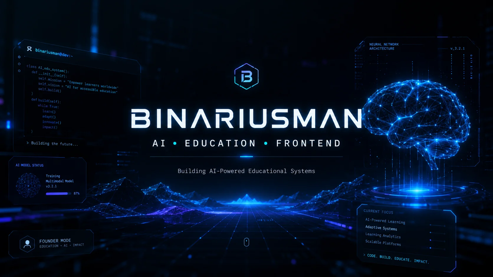

<div align="center">



<br>
<br>

# ⚡ BINARIUSMAN

### AI • FRONTEND • EDUCATION SYSTEMS

<p>
Building modern educational experiences powered by AI.
</p>

<br>


</div>

---


## 🧠 Sobre mí

```yaml
nombre: Rafael
alias: Binariusman
rol: Constructor de Sistemas AI & Arquitecto Frontend
ubicacion: Puebla, México

mision:
  Crear sistemas educativos potenciados por inteligencia artificial.

enfoque:
  - Ecosistema Astro
  - Workflows con IA
  - Sistemas UI Modernos
  - Automatización
  - Tecnología Educativa

filosofia:
  - Aprender profundamente
  - Construir constantemente
  - Diseñar para humanos
  - Utilizar IA como multiplicador
```

## 🚀 Proyectos destacados

| Proyecto | Qué es | Stack |
|---|---|---|
| [TaskManager Personal](https://github.com/binariusman/Recordatorios_Dekstop_Android) | App de escritorio local, sin suscripción, para gestión de tareas con avisos fiables en la bandeja del sistema y persistencia en SQLite. MVP 1.0.0 cerrado y validado. | Electron, TypeScript, SQLite |
| [PDFImageGridLayout](https://github.com/binariusman/PDFImageGridLayout) | Herramienta para organizar e imprimir imágenes en retículas y exportarlas a PDF a 300 DPI, con GUI y CLI. | Python, Pillow, CustomTkinter |
| [EnsaWeb](https://github.com/binariusman/EnsaWeb) | Plataforma web institucional de ENSA Tehuacán: bachillerato, preparatoria y certificaciones oficiales SEP, con enfoque en rendimiento y SEO. | Astro, Tailwind CSS, TypeScript |

## 🛠️ Stack


## 🔭 Construyendo actualmente

- Plataforma ENSA Web
- Sistemas educativos mejorados con IA
- Interfaces responsivas modernas
- Workflows de automatización

## 📫 Contacto

- GitHub: [@binariusman](https://github.com/binariusman)
- X: [@binariusman](https://x.com/binariusman)
- Instagram: [@binariusman](https://instagram.com/binariusman)
